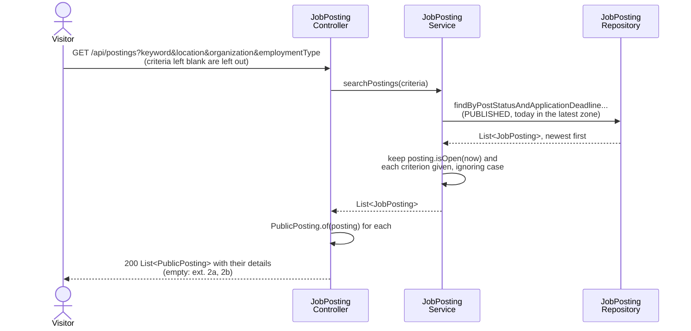
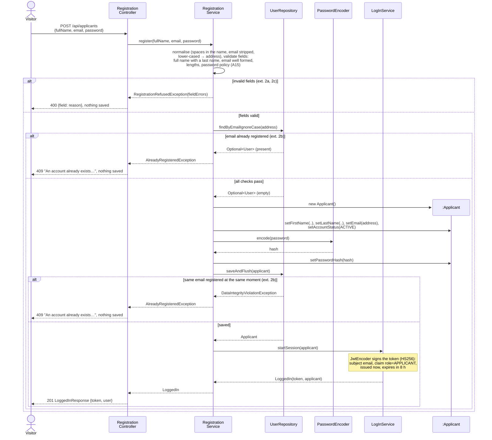
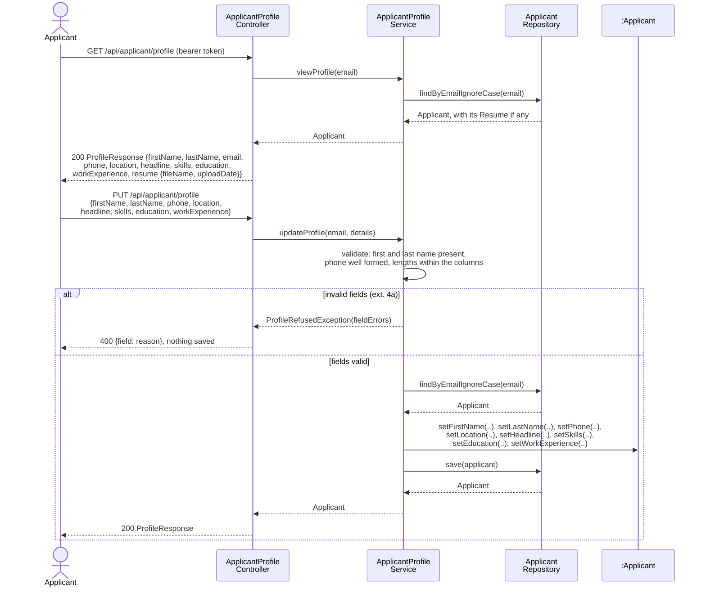
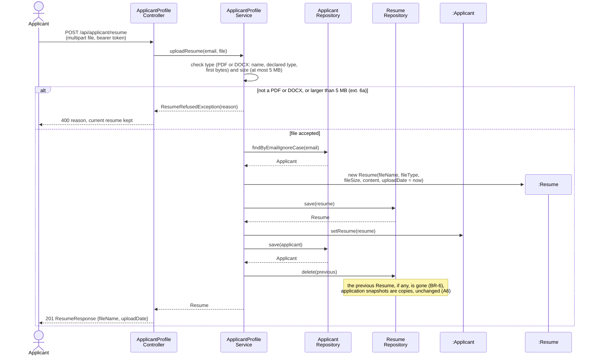
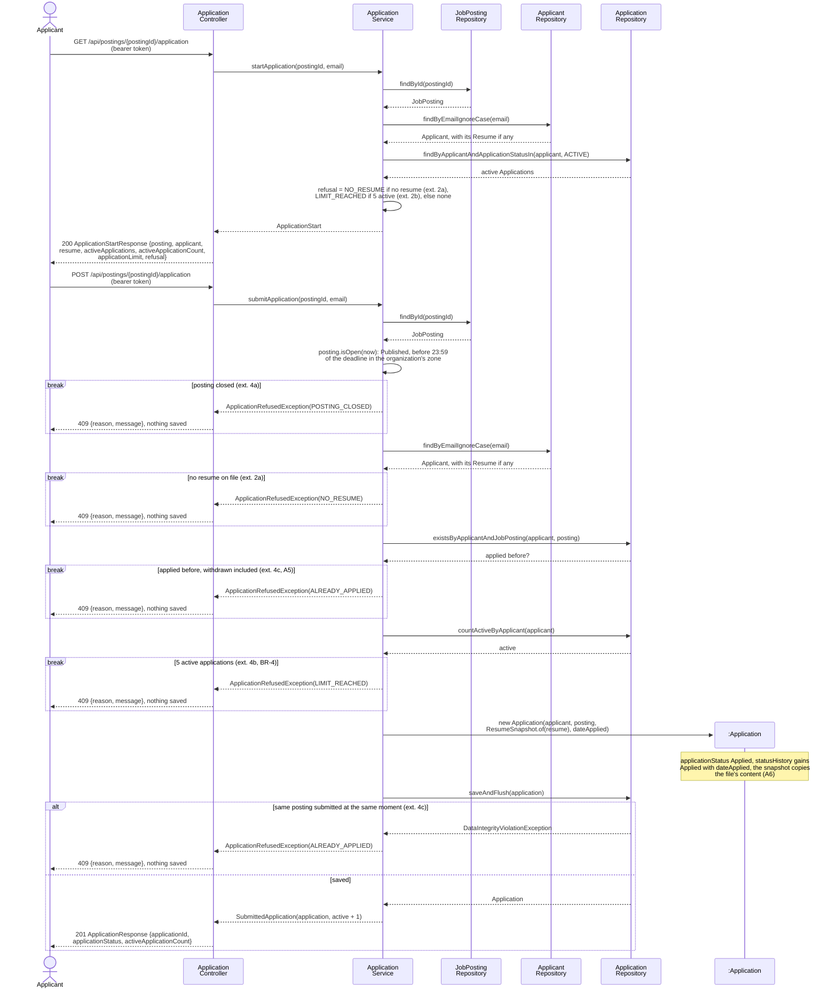
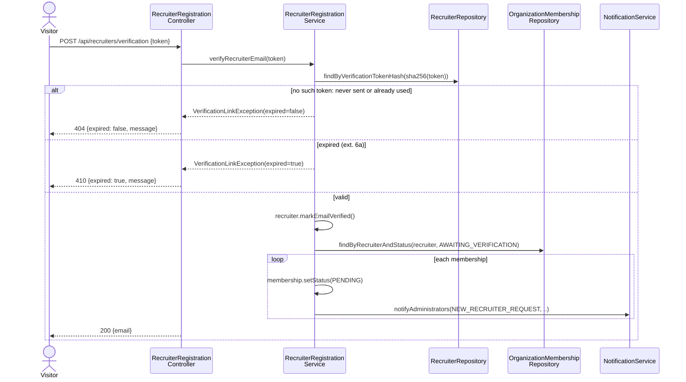
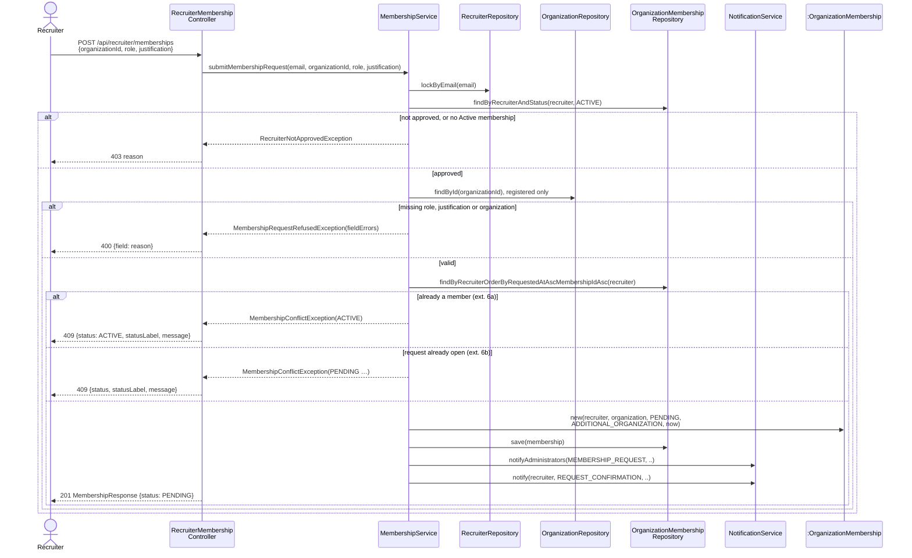
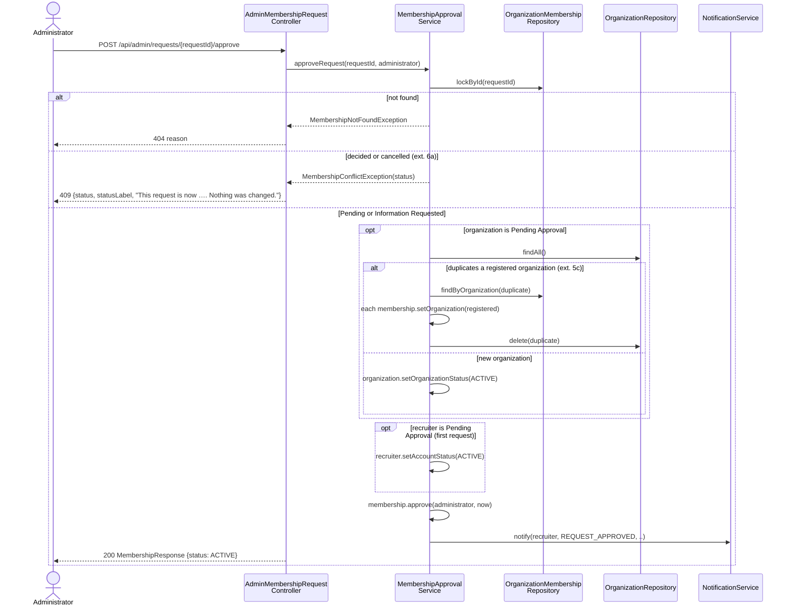

# CareerBridge — Design

> Part of the CareerBridge specification — see the [index](README.md).

## 6. Sequence Diagrams (Design)

One design sequence diagram per system operation of the implemented use cases, and the design of
use cases not built yet. Each shows how the objects of [architecture.md](architecture.md) realize an
operation contract of [ssd-and-contracts.md](ssd-and-contracts.md):

- a diagram starts at the HTTP request the actor sends to a controller and ends at its response;
  pages and other user-interface steps are left out (Deliverable 3 feedback);
- the controller hands the request to the service method named after the system operation;
- the service applies the business rules, creates and changes entities and calls repositories;
- a refusal is an exception that the controller turns into an HTTP status with a reason in plain
  text or, for refused fields, a field-to-reason map;
- names are the class and method names in the code on `main`.

The diagrams are Mermaid source, so GitHub draws them and the Deliverable PDF is rendered from the
same text.

### UC-01 Search Job Postings

One request carries the visitor's criteria, any of them blank, and one answer returns the matching
open postings with all their details (CO-01.1). The service loads the published postings whose
deadline date has not passed anywhere, keeps those still open at this moment in their
organization's time zone (`JobPosting.isOpen`, BR-10) and filters them by each criterion given,
ignoring case: a keyword is part of the title, description or requirements, an organization is part
of its name, and location and employment type match exactly. It returns them newest first
(FR-UC01.1, FR-UC01.2). The controller turns each posting into a `PublicPosting`, which leaves out
who approved it and when, the review comment and the organization's account status, and adds the
moment applications close, so the answer holds no internal data (BR-3). An empty answer is
extension 2a with no criteria, 2b with criteria.



**Figure 26: SD-1 Search Job Postings (UC-01)**

### UC-02 Register as Applicant

The service first normalises the input, collapsing any spaces in the full name and stripping and
lower-casing the email address, the way log-in looks it up, and checks the fields of CO-02.1: a full
name with a last name, a well-formed email address, at most 255 characters each, and the password
policy of A15 (at least 10 characters, including a letter and a number; at most 72 bytes, which
BCrypt reads). Every invalid field comes back at once with its reason (extensions 2a, 2c). Only then
does the service look the address up and refuse it if an account already exists (2b). Otherwise it
creates the Applicant as Active, keeps only a hash of the password and saves it; the unique
constraint on the email turns two registrations at the same moment into the same refusal. No
verification email is sent (A15): LogInService signs a token for the new Applicant (ADR-0010), and
the answer carries it, so the Applicant is logged in.



**Figure 27: SD-8 Register as an applicant (UC-02)**

### UC-03 Update Applicant Profile

Viewing and saving the profile (SD-9, CO-03.1 and CO-03.2) and uploading a resume (SD-10, CO-03.3)
are built. The logged-in Applicant is the subject of the session token (ADR-0010); the
controller passes that email to the service, so an applicant can only ever read and change their own
profile (BR-15). CO-03.2 changes First Name and Last Name, which every User has, and phone #,
location, headline, skills, education and work experience, the profile details of step 2.

**SD-9.** The service reads the Applicant with the resume on file, if any (CO-03.1). On save it
checks the fields (a first and a last name, a well-formed phone number or none, as registration
does not ask for one, and no field longer than its column: 255 characters for the names, location
and headline, 2,000 for skills, 4,000 for education, 10,000 for work experience) and returns every
invalid one with its reason (extension 4a); otherwise it changes the Applicant (CO-03.2).



**Figure 28: SD-9 Update applicant profile (UC-03)**

**SD-10.** The file comes as a multipart upload. The service accepts only a PDF or DOCX of at most
5 MB: the file name's extension, the type the browser declares (or none, or
`application/octet-stream`) and the file's first bytes (`%PDF`, or the `PK` of the zip a DOCX is)
must agree. Otherwise it refuses the file with a reason in plain text that states the accepted
types and size, keeping the current resume (extension 6a). A file over the multipart limit never
reaches the service; the controller answers it with the same reason. An accepted file becomes a
new Resume with its name, type, size, content and upload date (UTC), stored in the database, and
replaces the Applicant's previous one: an applicant has at most one resume (BR-6). The previous
Resume is deleted, as nothing else refers to it: applications already submitted keep their own
Resume Snapshot, an embedded copy with the file's content that submitApplication (CO-04.1) makes
from the resume on file, so replacing the resume changes none of them (FR-UC03.3, A6). No
external malware scanner is used (Iteration 1 feedback).



**Figure 29: SD-10 Upload a resume (UC-03)**

### UC-04 Apply for Job

SD-3 keeps the number it had in Deliverable 3. It shows startApplication, which presents the
application summary, and submitApplication (CO-04.1). The logged-in Applicant is the subject of the
session token (ADR-0010). Only the Applicant role reaches `/api/postings/{postingId}/application`:
a visitor who is not logged in is answered 401 and a Recruiter or Administrator 403 (extensions 1a,
1b). A posting that does not exist is 404.

startApplication only reads. A missing resume (extension 2a) or 5 active applications (2b) comes
back as a refusal inside the answer, not as an error, so the screen shows it beside the summary.

submitApplication checks, in this order: the posting is Published and its deadline day is not over
in the organization's time zone (4a, BR-10); a resume is on file (2a, BR-6); the applicant has never
applied to this posting, in any stage, withdrawn included (4c, A5); and the applicant has fewer than
5 active applications (4b, BR-4). Each refusal is an ApplicationRefusedException with a reason
written for the applicant, which the controller answers with 409. Only then does the service create
the Application. It gets the date applied in the organization's time zone, a Resume Snapshot that
copies the file's content, so a later resume changes nothing (A6), and the first status history
entry, Applied. The unique constraint on applicant and posting turns a double click into the 4c
refusal. The answer carries the new count of active applications for step 7.

Not built yet: the confirmation of step 6 (no Notification is created) and the limit of 5 under
submissions at the same moment to different postings, which the count alone does not hold.



**Figure 30: SD-3 Apply for a job (UC-04)**

### UC-08 Register Recruiter and Organization

Registration creates the Recruiter as Pending Approval, the Organization as Pending Approval unless
the name already belongs to a registered one (extension 4c), and an Organization Membership as
Awaiting Verification, then asks for email verification. Only a verified request reaches the
Administrator's queue.

The service checks every field first, with the same rules as UC-02 for the name, email and password
plus a job title and the organization's legal name and website (4a). An email already registered is
refused (4b); for an approved recruiter the reason points to UC-09. A registered organization is one
whose normalized legal name (lower case, punctuation and suffixes such as "Inc." and "Co." dropped)
or website domain matches the new one (FR-UC08.3); the visitor is offered membership in it and, on
accepting, sends the registration again with its `joinOrganizationId` (4c). A work email outside the
organization's website domain is accepted but flagged for the Administrator (4d, A17). The emailed
link holds a random token; only its SHA-256 hash is stored, and it expires after 24 hours (6a).
NotificationService stands in for the Notification Service: it saves each Notification as Pending
and logs it (7a). Without a mail service, a demonstration or the test database
(`careerbridge.demo.verification-links`, or an in-memory database) hands the link back in the answer.

```mermaid
sequenceDiagram
    actor V as Visitor
    participant RC as RecruiterRegistration<br/>Controller
    participant RS as RecruiterRegistration<br/>Service
    participant UR as UserRepository
    participant OR as OrganizationRepository
    participant MR as OrganizationMembership<br/>Repository
    participant NS as NotificationService
    participant R as :Recruiter
    participant M as :OrganizationMembership

    V->>RC: POST /api/recruiters<br/>{fullName, jobTitle, email, phone, password,<br/>organization | joinOrganizationId}
    RC->>RS: submitRecruiterRegistration(recruiterData,<br/>organizationData, joinOrganizationId)
    RS->>RS: validate fields (AccountRules, OrganizationRules)
    alt invalid fields (ext. 4a)
        RS-->>RC: RegistrationRefusedException(fieldErrors)
        RC-->>V: 400 {field: reason}, nothing saved
    else fields valid
        RS->>UR: findByEmailIgnoreCase(email)
        alt email already registered (ext. 4b)
            RS-->>RC: AlreadyRegisteredException
            RC-->>V: 409 {reason: EMAIL_REGISTERED, message}
        else new email
            opt new organization
                RS->>OR: findAll()
                alt duplicates a registered organization (ext. 4c)
                    RS-->>RC: OrganizationAlreadyRegisteredException(organization)
                    RC-->>V: 409 {reason: ORGANIZATION_REGISTERED, organization}
                end
            end
            RS->>R: new Recruiter(), accountStatus PENDING_APPROVAL,<br/>emailVerified false, startVerification(hash, +24 h)
            RS->>UR: saveAndFlush(recruiter)
            opt new organization
                RS->>OR: save(organization PENDING_APPROVAL)
            end
            RS->>M: new(recruiter, organization, AWAITING_VERIFICATION,<br/>requestType, now); setReviewFlag(..) (ext. 4d)
            RS->>MR: save(membership)
            RS->>NS: notify(recruiter, EMAIL_VERIFICATION, link)
            RS-->>RC: RecruiterRegistration(membership, link?)
            RC-->>V: 201 {email, organizationName, joinsExistingOrganization, verificationLink?}
        end
    end
```

**Figure 31: SD-11 Register a recruiter and organization (UC-08)**



**Figure 32: SD-12 Verify a recruiter's email (UC-08)**

### UC-09 Join Additional Organization

Searching organizations is a read of OrganizationRepository and changes nothing
(`GET /api/organizations?query=`, no role; only registered organizations, matched on name and
website). The request is refused if the recruiter is already a member (extension 6a) or has a
request pending (6b); both are MembershipConflictException (409) with the existing status. A
denied or cancelled request does not block a new one. The recruiter's row is locked while the
request is checked, so two requests sent at once are checked one after the other. CO-09.1's
preconditions are checked too: the account is Active and has at least one Active membership.
Extension 3a sends the new organization's details instead of an id; it is created Pending Approval
after the same duplicate check as UC-08. A pending request can be cancelled (\*a).



**Figure 33: SD-13 Ask to join another organization (UC-09)**

### UC-10 Approve Recruiter/Organization Request

Only the Administrator role reaches `/api/admin/**`. Approval activates the membership and, for a
first request, the recruiter's account and the new organization. If the new organization
duplicates a registered one (extension 5c) it is deleted and the membership points to the
existing one. A request already decided or cancelled is MembershipConflictException (409;
extension 6a). The request's row is locked, so a second Administrator waits and then finds it
decided. Denying (5a) and asking for information (5b) need a note, which the requester receives;
an account or organization created only for a denied request becomes Inactive. Every decision
records who decided and when (NFR-UC10.1).



**Figure 34: SD-14 Approve a recruiter or organization request (UC-10)**

## 7. Design Class Diagram (DCD)

Not written yet. Iteration 2 adds the design class diagram, consistent with the sequence diagrams
above and with the [domain model](domain-model.md).

### 7.1 Consistency with the sequence diagrams

Every system operation in a sequence diagram above, and the classes and methods that realize it;
the DCD must contain each of them.

| Diagram | Controller method | Service method | Repository calls |
| --- | --- | --- | --- |
| SD-1 | `JobPostingController.searchPostings`; `PublicPosting.of` | `JobPostingService.searchPostings`; `JobPosting.isOpen` | `JobPostingRepository.findByPostStatusAndApplicationDeadlineGreaterThanEqualOrderByDatePostedDescJobPostIdDesc` |
| SD-3 | `ApplicationController.startApplication`, `submitApplication` | `ApplicationService.startApplication`, `submitApplication`; `JobPosting.isOpen`; `ResumeSnapshot.of` | `JobPostingRepository.findById`; `ApplicantRepository.findByEmailIgnoreCase`; `ApplicationRepository.findByApplicantAndApplicationStatusIn`, `existsByApplicantAndJobPosting`, `countActiveByApplicant`, `saveAndFlush` |
| SD-8 | `RegistrationController.register` | `RegistrationService.register`; `LogInService.startSession` | `UserRepository.findByEmailIgnoreCase`, `saveAndFlush` |
| SD-9 | `ApplicantProfileController.viewProfile`, `updateProfile` | `ApplicantProfileService.viewProfile`, `updateProfile` | `ApplicantRepository.findByEmailIgnoreCase`, `save` |
| SD-10 | `ApplicantProfileController.uploadResume` | `ApplicantProfileService.uploadResume` | `ApplicantRepository.findByEmailIgnoreCase`, `save`; `ResumeRepository.save`, `delete` |
| SD-11 | `RecruiterRegistrationController.submitRecruiterRegistration` | `RecruiterRegistrationService.submitRecruiterRegistration`; `OrganizationRules.rejectDuplicate`; `NotificationService.notify` | `UserRepository.findByEmailIgnoreCase`; `RecruiterRepository.saveAndFlush`; `OrganizationRepository.findAll`, `findByName`, `save`; `OrganizationMembershipRepository.save` |
| SD-12 | `RecruiterRegistrationController.verifyRecruiterEmail` | `RecruiterRegistrationService.verifyRecruiterEmail`; `NotificationService.notifyAdministrators` | `RecruiterRepository.findByVerificationTokenHash`; `OrganizationMembershipRepository.findByRecruiterAndStatus` |
| SD-13 | `RecruiterMembershipController.submitMembershipRequest` | `MembershipService.submitMembershipRequest`; `NotificationService.notify`, `notifyAdministrators` | `RecruiterRepository.lockByEmail`; `OrganizationRepository.findById`; `OrganizationMembershipRepository.findByRecruiterAndStatus`, `findByRecruiterOrderByRequestedAtAscMembershipIdAsc`, `save` |
| SD-14 | `AdminMembershipRequestController.approveRequest` | `MembershipApprovalService.approveRequest`; `NotificationService.notify` | `OrganizationMembershipRepository.lockById`, `findByOrganization`; `OrganizationRepository.findAll`, `delete` |
