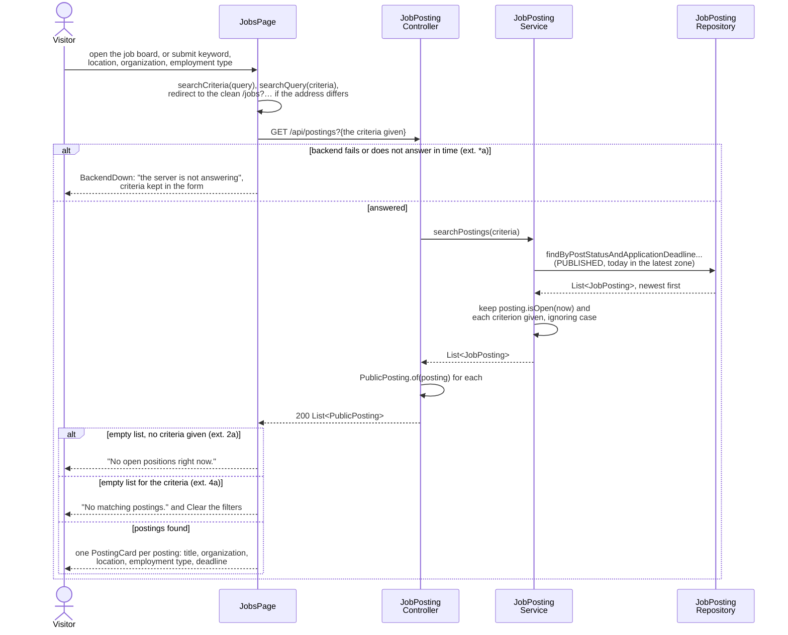
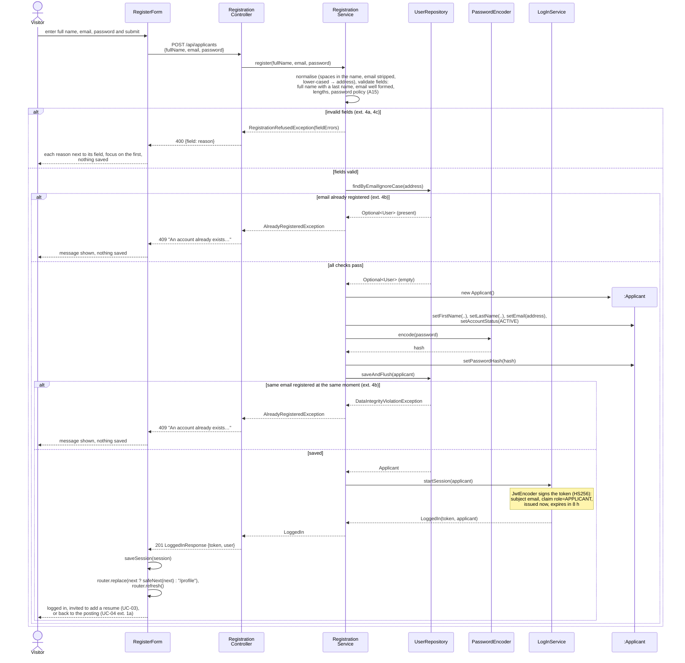

# CareerBridge — Design

> Part of the CareerBridge specification — see the [index](README.md).

## 6. Sequence Diagrams (Design)

One design sequence diagram per system operation of the implemented use cases. Each shows how the
objects of [architecture.md](architecture.md) realize an operation contract of
[ssd-and-contracts.md](ssd-and-contracts.md):

- the page sends one HTTP request (the call in `lib/api.ts` is folded into it);
- a controller hands it to the service method named after the system operation;
- the service applies the business rules, creates and changes entities and calls repositories;
- a refusal is an exception that the controller turns into an HTTP status with a reason in plain
  text or, for refused fields, a field-to-reason map;
- names are the class and method names in the code on `main`.

The diagrams are Mermaid source, so GitHub draws them and the Deliverable PDF is rendered from the
same text.

### UC-01 Search Job Postings

The job board is a server-rendered page: it reads the criteria from its address, first redirects to
a clean address that holds only the criteria given, so a search can be bookmarked and shared, and
asks the backend for the open postings with one request. The service loads the published postings
whose deadline date has not passed anywhere, keeps those still open at this moment in their
organization's time zone (`JobPosting.isOpen`, BR-10) and filters them by each criterion, ignoring
case: a keyword is part of the title, description or requirements, an organization is part of its
name, and location and employment type match exactly. It returns them newest first (FR-UC01.1,
FR-UC01.2). The controller turns each posting into a `PublicPosting`, which leaves out who approved
it and when, the review comment and the organization's account status, and adds the moment
applications close, so the public page shows no internal data (BR-3). With no criteria, an empty
answer ends the use case with a message (extension 2a); an empty answer to a search shows a message
and a link that clears the filters, and the visitor searches again (extension 4a). If the backend
does not answer, the page says so and keeps the criteria (extension *a). Opening one posting from
the list is a page of its own, not a step of UC-01 (Iteration 1 feedback).

**Figure 26: SD-1 Search Job Postings (UC-01)**

### UC-02 Register as Applicant

A logged-in user who opens `/register` is sent to their profile (precondition of UC-02). The service
first normalises the input, collapsing any spaces in the full name and stripping and lower-casing the
email address, the way log-in looks it up, and checks the fields of CO-02.1: a full name with a last
name, a well-formed email address, at most 255 characters each, and the password policy of A15 (at
least 10 characters, including a letter and a number; at most 72 bytes, which BCrypt reads). Every
invalid field comes back at once with its reason, so the form shows each one next to its field and
moves the focus to the first. Only then does the service look the address up and refuse it if an
account already exists, suggesting to log in instead. Otherwise it creates the Applicant as Active,
keeps only a hash of the password and saves it; the unique constraint on the email turns two
registrations at the same moment into the same refusal. No verification email is sent (A15):
LogInService signs a token for the new Applicant (ADR-0010), and the form saves the session and
opens the profile, where the Applicant is invited to add a resume (UC-03), or the posting the
visitor came from to apply (UC-04 extension 1a). Any other failure shows "Unable to create the
account. Please try again." (extension *a).

**Figure 27: SD-8 Register as an applicant (UC-02)**

## 7. Design Class Diagram (DCD)

Not written yet. Iteration 2 adds the design class diagram, consistent with the sequence diagrams
above and with the [domain model](domain-model.md).

### 7.1 Consistency with the sequence diagrams

Every system operation in a sequence diagram above, and the classes and methods that realize it;
the DCD must contain each of them.

| Diagram | Controller method | Service method | Repository calls |
| --- | --- | --- | --- |
| SD-1 | `JobPostingController.searchPostings`; `PublicPosting.of` | `JobPostingService.searchPostings`; `JobPosting.isOpen` | `JobPostingRepository.findByPostStatusAndApplicationDeadlineGreaterThanEqualOrderByDatePostedDescJobPostIdDesc` |
| SD-8 | `RegistrationController.register` | `RegistrationService.register`; `LogInService.startSession` | `UserRepository.findByEmailIgnoreCase`, `saveAndFlush` |
