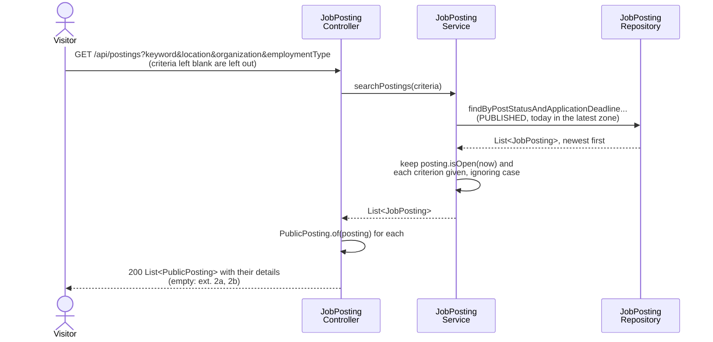
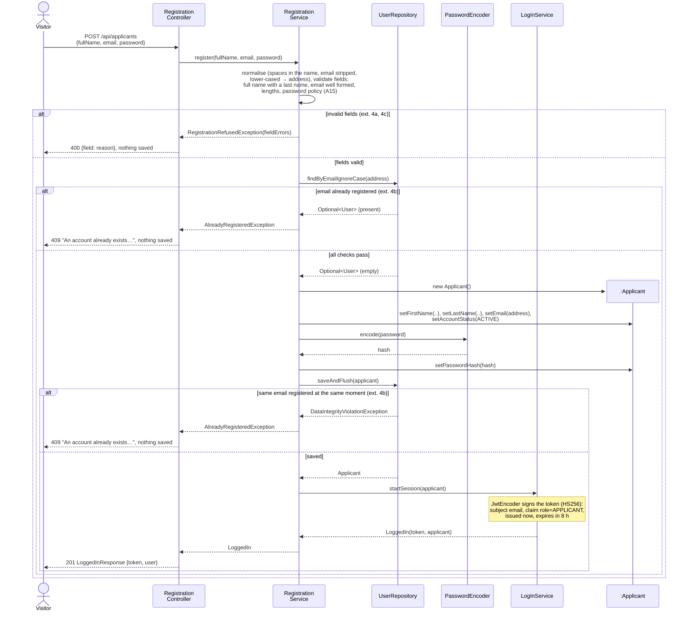
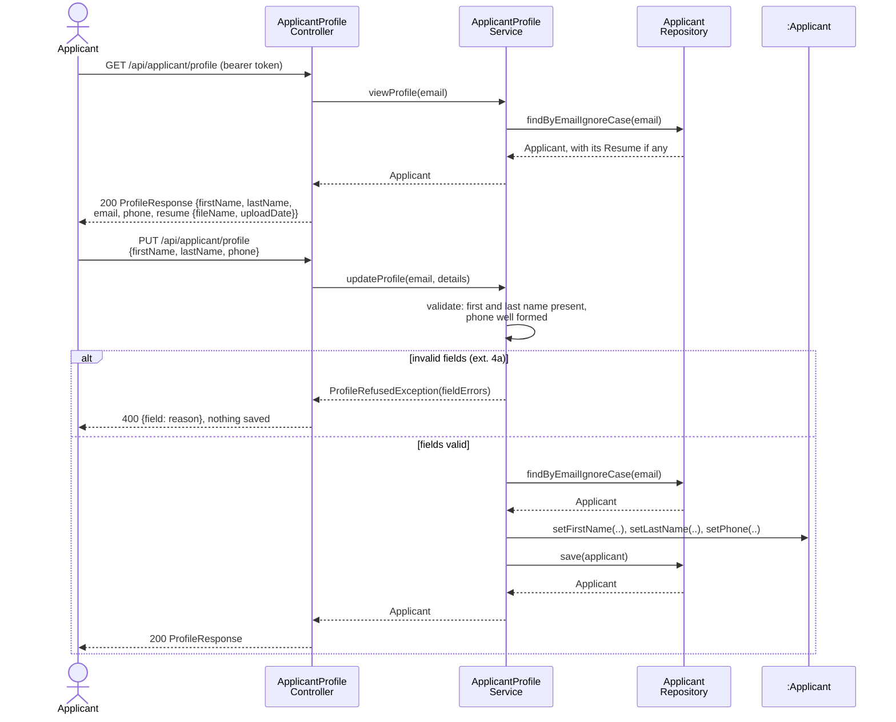
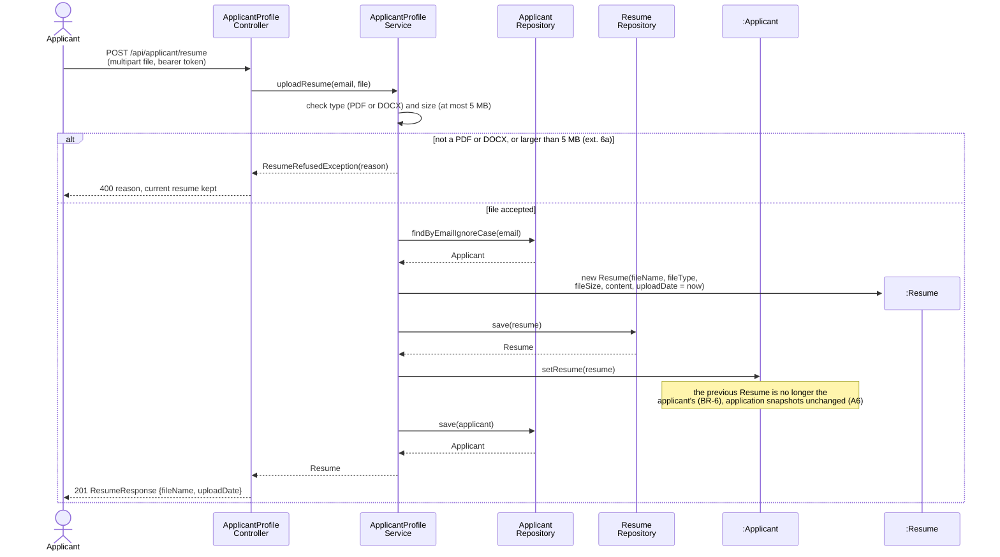

# CareerBridge — Design

> Part of the CareerBridge specification — see the [index](README.md).

## 6. Sequence Diagrams (Design)

One design sequence diagram per system operation of the implemented use cases, and the design of
use cases not built yet. Each shows how the objects of [architecture.md](architecture.md) realize an
operation contract of [ssd-and-contracts.md](ssd-and-contracts.md):

- a diagram starts at the HTTP request the actor sends to a controller and ends at its response;
  pages and other user-interface steps are left out (Deliverable 3 feedback);
- the controller hands the request to the service method named after the system operation;
- the service applies the business rules, creates and changes entities and calls repositories;
- a refusal is an exception that the controller turns into an HTTP status with a reason in plain
  text or, for refused fields, a field-to-reason map;
- names are the class and method names in the code on `main`.

The diagrams are Mermaid source, so GitHub draws them and the Deliverable PDF is rendered from the
same text.

### UC-01 Search Job Postings

One request carries the visitor's criteria, any of them blank, and one answer returns the matching
open postings with all their details (CO-01.1). The service loads the published postings whose
deadline date has not passed anywhere, keeps those still open at this moment in their
organization's time zone (`JobPosting.isOpen`, BR-10) and filters them by each criterion given,
ignoring case: a keyword is part of the title, description or requirements, an organization is part
of its name, and location and employment type match exactly. It returns them newest first
(FR-UC01.1, FR-UC01.2). The controller turns each posting into a `PublicPosting`, which leaves out
who approved it and when, the review comment and the organization's account status, and adds the
moment applications close, so the answer holds no internal data (BR-3). An empty answer is
extension 2a with no criteria, 2b with criteria.

**Figure 26: SD-1 Search Job Postings (UC-01)**

### UC-02 Register as Applicant

The service first normalises the input, collapsing any spaces in the full name and stripping and
lower-casing the email address, the way log-in looks it up, and checks the fields of CO-02.1: a full
name with a last name, a well-formed email address, at most 255 characters each, and the password
policy of A15 (at least 10 characters, including a letter and a number; at most 72 bytes, which
BCrypt reads). Every invalid field comes back at once with its reason (extensions 4a, 4c). Only then
does the service look the address up and refuse it if an account already exists (4b). Otherwise it
creates the Applicant as Active, keeps only a hash of the password and saves it; the unique
constraint on the email turns two registrations at the same moment into the same refusal. No
verification email is sent (A15): LogInService signs a token for the new Applicant (ADR-0010), and
the answer carries it, so the Applicant is logged in.

**Figure 27: SD-8 Register as an applicant (UC-02)**

### UC-03 Update Applicant Profile

Viewing the profile (the first half of SD-9, CO-03.1) is built; saving it (the second half) and
SD-10 are the design for the rest of Iteration 3, in the shape of the code that exists. The logged-in Applicant is the subject of the session token (ADR-0010); the
controller passes that email to the service, so an applicant can only ever read and change their own
profile (BR-15). CO-03.2 changes First Name, Last Name and phone #, the User attributes of the
domain model; the other profile fields of step 2 wait for the domain model to have them.

**SD-9.** The service reads the Applicant with the resume on file, if any (CO-03.1). On save it
checks the fields (a first and a last name, a well-formed phone number) and returns every invalid
one with its reason (extension 4a); otherwise it changes the Applicant (CO-03.2).

**Figure 28: SD-9 Update applicant profile (UC-03)**

**SD-10.** The file comes as a multipart upload. The service accepts only a PDF or DOCX of at most
5 MB and otherwise refuses it, keeping the current resume (extension 6a). An accepted file becomes a
new Resume with its name, type, size and upload date, stored in the database, and replaces the
Applicant's previous one: an applicant has at most one resume (BR-6). Applications already
submitted keep their own Resume Snapshot, so replacing the resume changes none of them (FR-UC03.3,
A6). No external malware scanner is used (Iteration 1 feedback).

**Figure 29: SD-10 Upload a resume (UC-03)**

## 7. Design Class Diagram (DCD)

Not written yet. Iteration 2 adds the design class diagram, consistent with the sequence diagrams
above and with the [domain model](domain-model.md).

### 7.1 Consistency with the sequence diagrams

Every system operation in a sequence diagram above, and the classes and methods that realize it;
the DCD must contain each of them.

| Diagram | Controller method | Service method | Repository calls |
| --- | --- | --- | --- |
| SD-1 | `JobPostingController.searchPostings`; `PublicPosting.of` | `JobPostingService.searchPostings`; `JobPosting.isOpen` | `JobPostingRepository.findByPostStatusAndApplicationDeadlineGreaterThanEqualOrderByDatePostedDescJobPostIdDesc` |
| SD-8 | `RegistrationController.register` | `RegistrationService.register`; `LogInService.startSession` | `UserRepository.findByEmailIgnoreCase`, `saveAndFlush` |
| SD-9 | `ApplicantProfileController.viewProfile`, `updateProfile` | `ApplicantProfileService.viewProfile`, `updateProfile` | `ApplicantRepository.findByEmailIgnoreCase`, `save` |
| SD-10 | `ApplicantProfileController.uploadResume` | `ApplicantProfileService.uploadResume` | `ApplicantRepository.findByEmailIgnoreCase`, `save`; `ResumeRepository.save` |
