# CareerBridge — Design

> Part of the CareerBridge specification — see the [index](README.md).

## 6. Sequence Diagrams (Design)

One design sequence diagram per system operation of the implemented use cases, and the design of
use cases not built yet. Each shows how the objects of [architecture.md](architecture.md) realize an
operation contract of [ssd-and-contracts.md](ssd-and-contracts.md):

- a diagram starts at the HTTP request the actor sends to a controller and ends at its response;
  pages and other user-interface steps are left out (Deliverable 3 feedback);
- the controller hands the request to the service method named after the system operation;
- the service applies the business rules, creates and changes entities and calls repositories;
- a refusal is an exception that the controller turns into an HTTP status with a reason in plain
  text or, for refused fields, a field-to-reason map;
- names are the class and method names in the code on `main`; a step that is designed but not
  built yet is drawn anyway, and the text under its diagram says so.

The diagrams are Mermaid source, so GitHub draws them and the Deliverable PDF is rendered from the
same text.

### UC-01 Search Job Postings

One request carries the visitor's criteria, any of them blank, and one answer returns the matching
open postings with all their details (CO-01.1). The service loads the published postings whose
deadline date has not passed anywhere, keeps those still open at this moment in their
organization's time zone (`JobPosting.isOpen`, BR-10) and filters them by each criterion given,
ignoring case: a keyword is part of the title, description or requirements, an organization is part
of its name, and location and employment type match exactly. It returns them newest first
(FR-UC01.1, FR-UC01.2). The controller turns each posting into a `PublicPosting`, which leaves out
who approved it and when, the review comment and the organization's account status, and adds the
moment applications close, so the answer holds no internal data (BR-3). An empty answer is
extension 2a with no criteria, 2b with criteria.

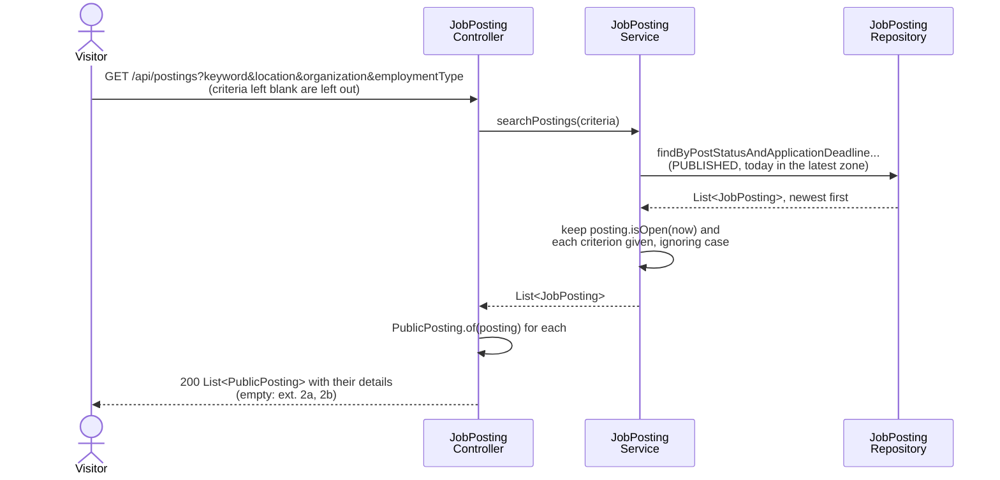

**Figure 26: SD-1 Search Job Postings (UC-01)**

### UC-02 Register as Applicant

The service first normalises the input, collapsing any spaces in the full name and stripping and
lower-casing the email address, the way log-in looks it up, and checks the fields of CO-02.1: a full
name with a last name, a well-formed email address, at most 255 characters each, and the password
policy of A15 (at least 10 characters, including a letter and a number; at most 72 bytes, which
BCrypt reads). Every invalid field comes back at once with its reason (extensions 2a, 2c). Only then
does the service look the address up and refuse it if an account already exists (2b). Otherwise it
creates the Applicant as Active, keeps only a hash of the password and saves it; the unique
constraint on the email turns two registrations at the same moment into the same refusal. No
verification email is sent (A15): LogInService signs a token for the new Applicant (ADR-0010), and
the answer carries it, so the Applicant is logged in.

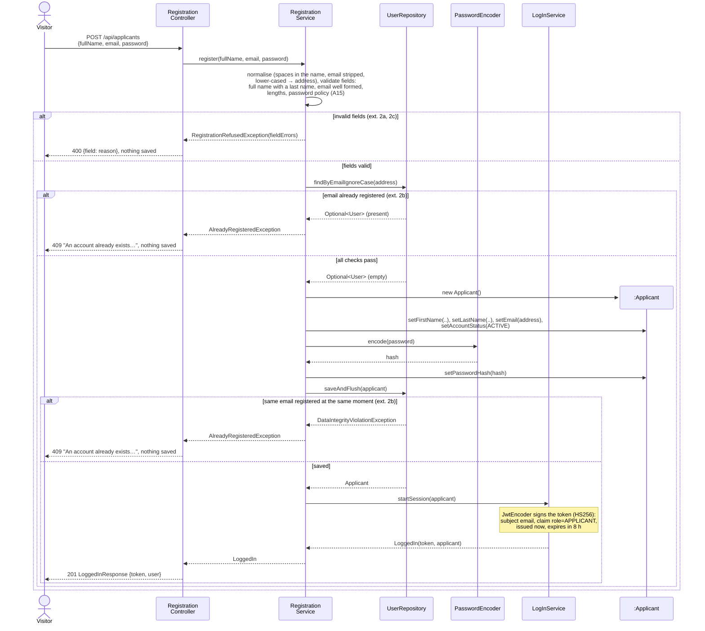

**Figure 27: SD-8 Register as an applicant (UC-02)**

### UC-03 Update Applicant Profile

Viewing and saving the profile (SD-9, CO-03.1 and CO-03.2) and uploading a resume (SD-10, CO-03.3)
are built. The logged-in Applicant is the subject of the session token (ADR-0010); the
controller passes that email to the service, so an applicant can only ever read and change their own
profile (BR-15). CO-03.2 changes First Name and Last Name, which every User has, and phone #,
location, headline, skills, education and work experience, the profile details of step 2.

**SD-9.** The service reads the Applicant with the resume on file, if any (CO-03.1). On save it
checks the fields (a first and a last name, a well-formed phone number or none, as registration
does not ask for one, and no field longer than its column: 255 characters for the names, location
and headline, 2,000 for skills, 4,000 for education, 10,000 for work experience) and returns every
invalid one with its reason (extension 4a); otherwise it changes the Applicant (CO-03.2).

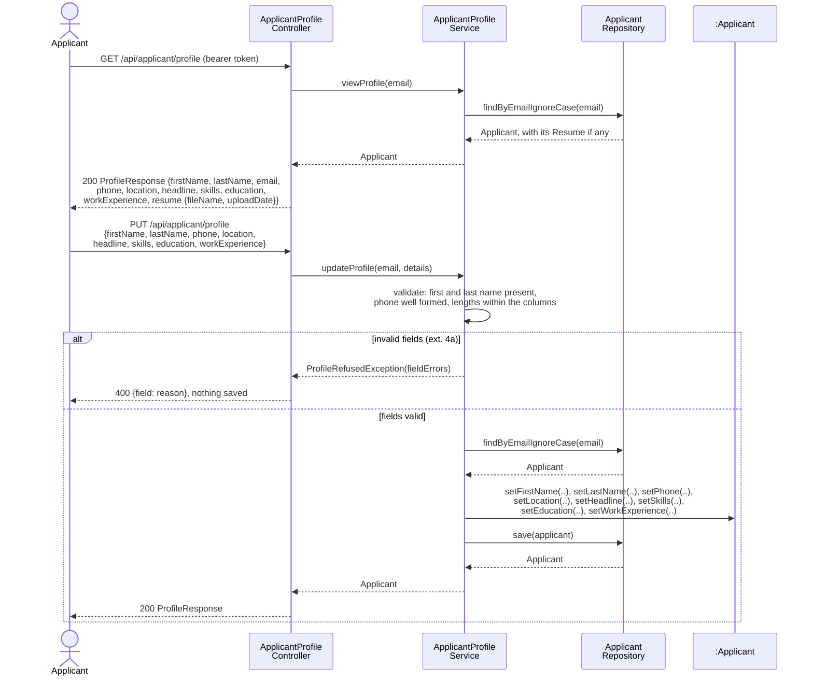

**Figure 28: SD-9 Update applicant profile (UC-03)**

**SD-10.** The file comes as a multipart upload. The service accepts only a PDF or DOCX of at most
5 MB: the file name's extension, the type the browser declares (or none, or
`application/octet-stream`) and the file's first bytes (`%PDF`, or the `PK` of the zip a DOCX is)
must agree. Otherwise it refuses the file with a reason in plain text that states the accepted
types and size, keeping the current resume (extension 6a). A file over the multipart limit never
reaches the service; the controller answers it with the same reason. An accepted file becomes a
new Resume with its name, type, size, content and upload date (UTC), stored in the database, and
replaces the Applicant's previous one: an applicant has at most one resume (BR-6). The previous
Resume is deleted, as nothing else refers to it: applications already submitted keep their own
Resume Snapshot, an embedded copy with the file's content that submitApplication (CO-04.1) makes
from the resume on file, so replacing the resume changes none of them (FR-UC03.3, A6). No
external malware scanner is used (Iteration 1 feedback).

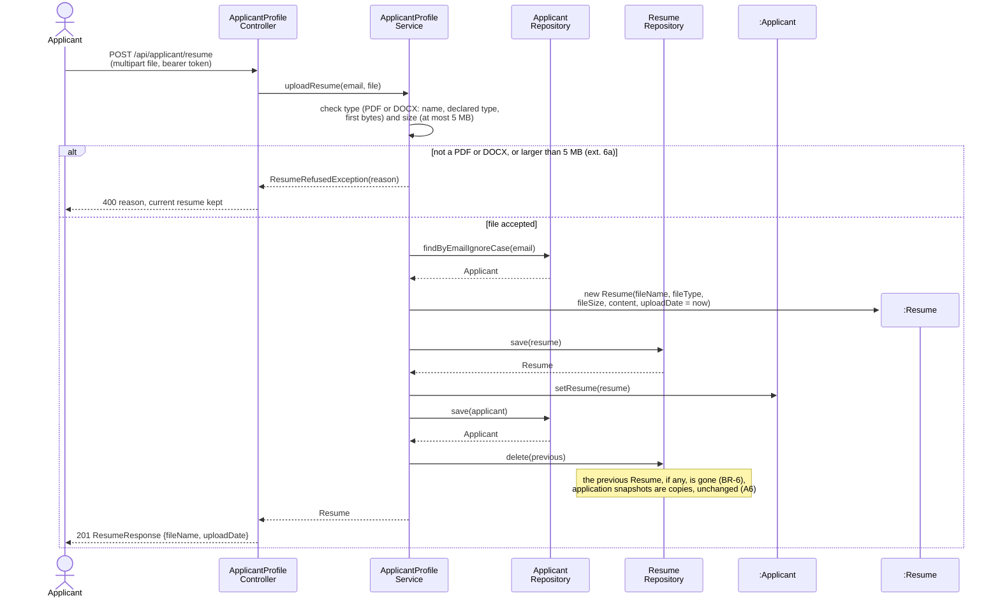

**Figure 29: SD-10 Upload a resume (UC-03)**

### UC-04 Apply for Job

SD-3 keeps the number it had in Deliverable 3. It shows startApplication, which presents the
application summary, and submitApplication (CO-04.1). The logged-in Applicant is the subject of the
session token (ADR-0010). Only the Applicant role reaches `/api/postings/{postingId}/application`:
a visitor who is not logged in is answered 401 and a Recruiter or Administrator 403 (extensions 1a,
1b). A posting that does not exist is 404.

startApplication only reads. A missing resume (extension 2a) or 5 active applications (2b) comes
back as a refusal inside the answer, not as an error, so the screen shows it beside the summary.

submitApplication checks, in this order: the posting is Published and its deadline day is not over
in the organization's time zone (4a, BR-10); a resume is on file (2a, BR-6); the applicant has never
applied to this posting, in any stage, withdrawn included (4c, A5); and the applicant has fewer than
5 active applications (4b, BR-4). Each refusal is an ApplicationRefusedException with a reason
written for the applicant, which the controller answers with 409. Only then does the service create
the Application. It gets the date applied in the organization's time zone, a Resume Snapshot that
copies the file's content, so a later resume changes nothing (A6), and the first status history
entry, Applied. The unique constraint on applicant and posting turns a double click into the 4c
refusal. The answer carries the new count of active applications for step 7.

Not built yet: the confirmation of step 6 (no Notification is created) and the limit of 5 under
submissions at the same moment to different postings, which the count alone does not hold.

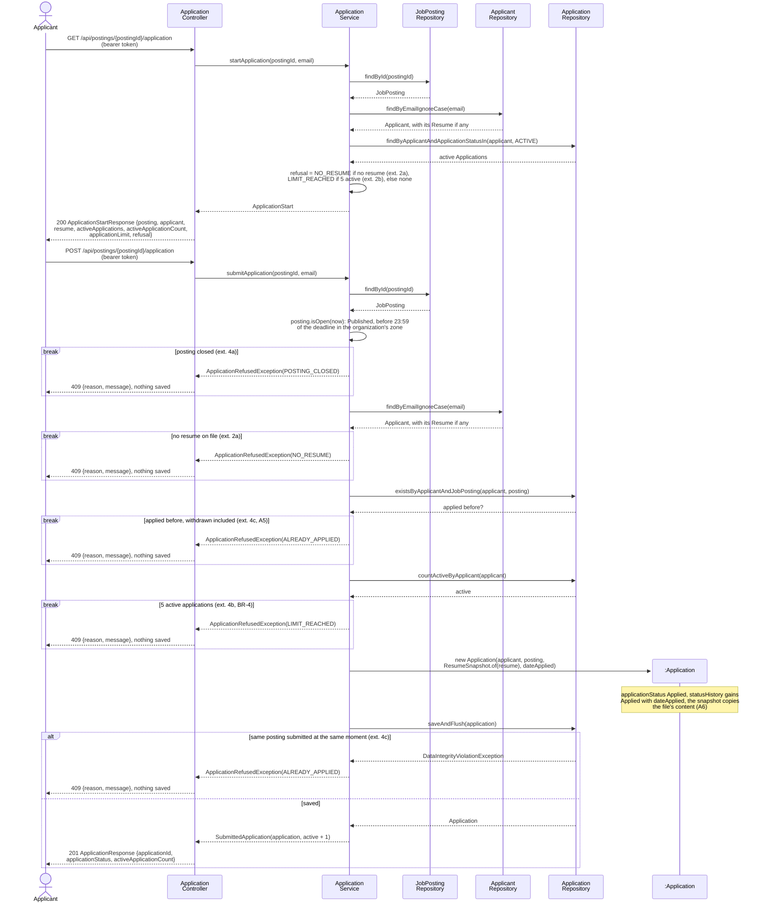

**Figure 30: SD-3 Apply for a job (UC-04)**

### UC-11 Create Job Posting

Creating a posting saves it as a Draft (SD-4, extension 3b); sending a Draft or a Returned posting
to the Administrator is a second request by its id (SD-5, CO-11.1, extension 6a). The logged-in
Recruiter is the subject of the session token (ADR-0010), and only the Recruiter role reaches
`POST /api/postings` and `/api/postings/{postingId}/submit`.

Both requests first check that the Recruiter is an Active member of the posting's organization
(precondition, extension \*a, BR-14): the service loads the Recruiter and their Active memberships
and refuses with 403 when the organization is not among them. The new posting is then linked to its
organization and to the Recruiter who created it (CO-11.1). The posting is linked to the Recruiter
who created it, and only that Recruiter may submit it (`JobPosting.wasCreatedBy`, SCRUM-215). The
membership lookup is drawn as designed; the code does not have it yet, because the Organization
Membership entity arrives with UC-08 to UC-10. Until then a recruiter may create a posting for any
organization that exists, but submits only their own.

The fields are checked in the order of extension 5a: the organization exists, the title is present
and at most 255 characters, the description, requirements, location, employment type and salary
range fit their columns, the deadline is not in the past and there is at least one opening. Each
refusal is an InvalidPostingException with a reason written for the recruiter, which the controller
answers with 400.

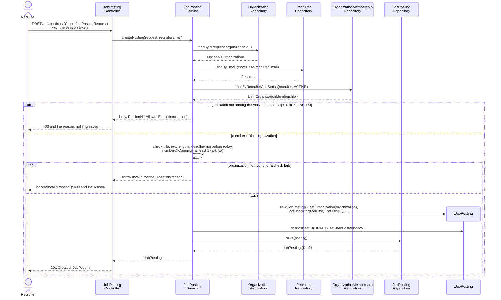

**Figure 31: SD-4 Create a job posting (UC-11)**

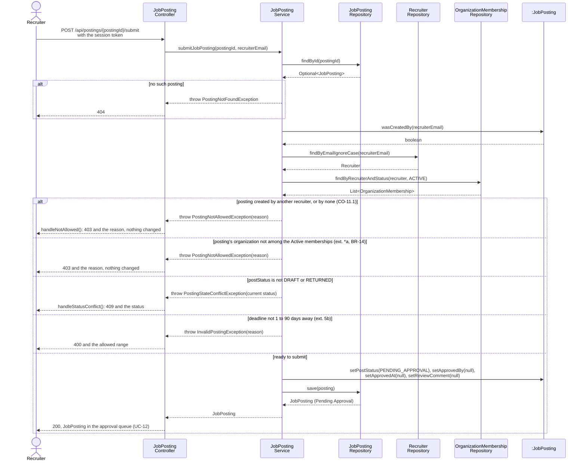

**Figure 32: SD-5 Submit a posting for approval (UC-11)**

### UC-12 Approve Job Posting

The queue is a query (SD-6): Pending Approval postings, oldest first; an empty list is extension
2a. A decision is one controller method and one service method per outcome (SD-7): approve, return
or reject. Only the Administrator role reaches `/api/admin/**`, and each decision records the
Administrator's name, taken from the session token, and the time. A posting that another
Administrator decided meanwhile is refused with 409 and its current status (extension 6c).

Approving checks, in this order: the deadline has not passed, or the posting goes back to the
recruiters as Returned with a request for a new deadline (6a); the organization is Active and the
submitting Recruiter still has an Active membership in it, or nothing changes and the posting stays
pending (6b, CO-12.1). The 6b check is drawn as designed and waits for the Organization Membership
entity, as for UC-11. Returning and rejecting need a comment (5a, 5b). The notices to the
organization's recruiters (step 7) are not built: there is no Notification yet.

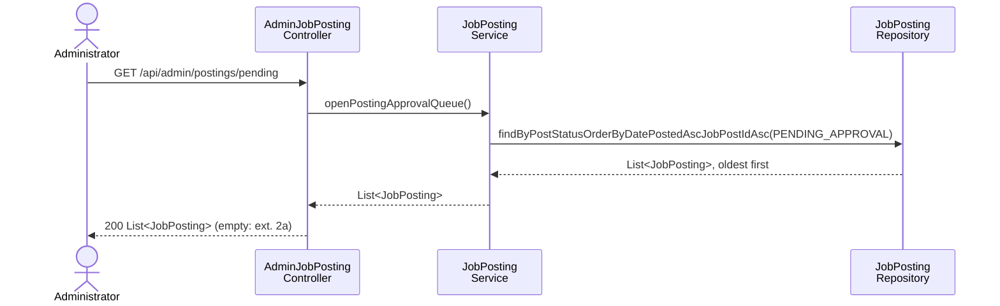

**Figure 33: SD-6 Open the posting approval queue (UC-12)**

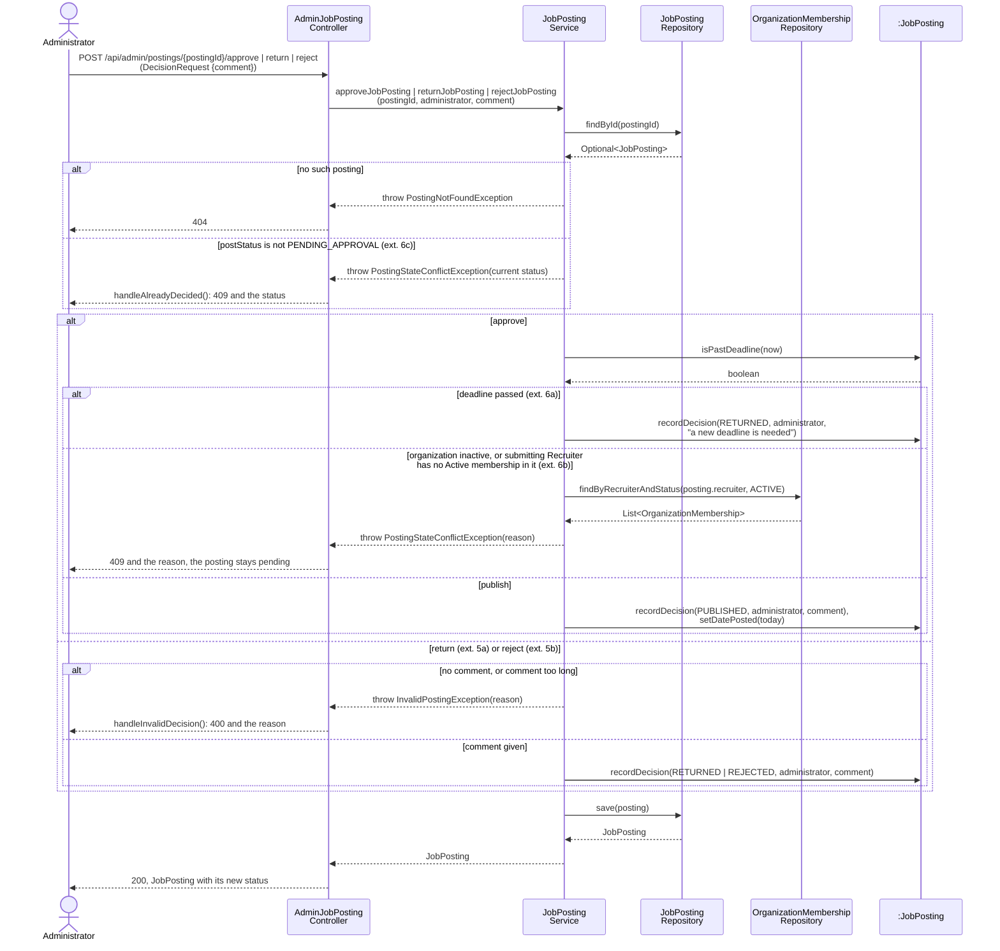

**Figure 34: SD-7 Approve, return or reject a posting (UC-12)**

### UC-13 Expire Job Posting

The actor is the Scheduler, so there is no controller and no session: JobPostingExpirationScheduler
starts a run when the application is ready and every 15 minutes after (FR-UC13.1). The service
loads every Published, Pending Approval or Returned posting whose deadline date has passed in the
earliest time zone, keeps those past 23:59 of the deadline in their organization's own time zone
(`JobPosting.isPastDeadline`, NFR-UC13.5), and hands each one to the processor. The processor
expires one posting in its own transaction, so one failure is logged and the run goes on, and the
failed posting is tried again on the next run (extension 3b, NFR-UC13.3). A Published posting
becomes Closed with the reason Expired and the time it closed (the Close Job Posting subfunction,
FR-UC13.3); a Pending Approval or Returned posting, never published, becomes Expired (extension 2b).
A posting already closed, for example filled, is left alone (3a), so a second run closes nothing
again (NFR-UC13.1). The run is logged with its start, the number closed and the errors (FR-UC13.8).
The notices of step 4 are not built: there is no Notification yet.

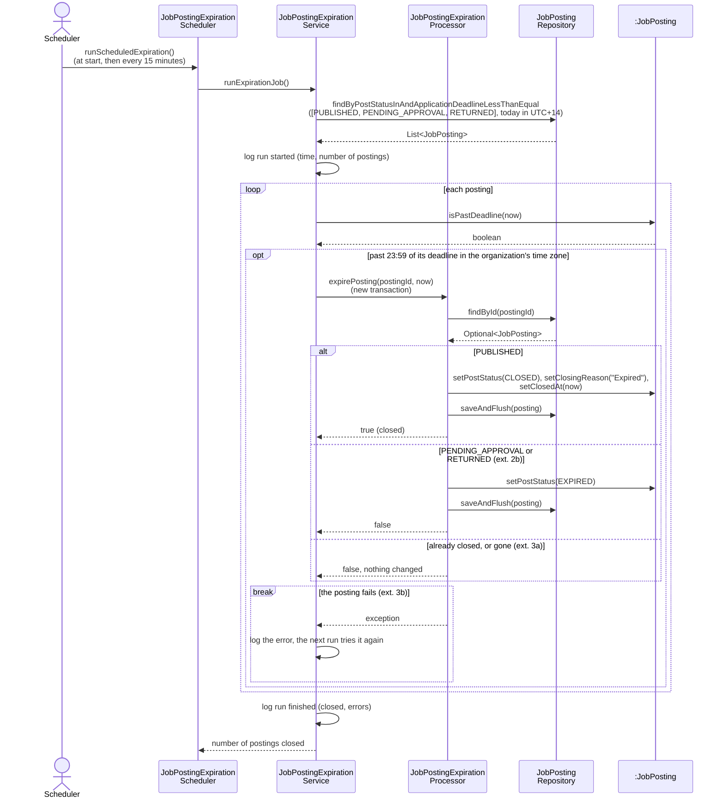

**Figure 35: SD-11 Expire job postings (UC-13)**

## 7. Design Class Diagram (DCD)

The design class diagram, consistent with the sequence diagrams above and with the
[domain model](domain-model.md). Section 7.2 holds the job-posting side; the other views are not
written here yet.

### 7.1 Consistency with the sequence diagrams

Every system operation in a sequence diagram above, and the classes and methods that realize it;
the DCD must contain each of them.

| Diagram | Controller method | Service method | Repository calls |
| --- | --- | --- | --- |
| SD-1 | `JobPostingController.searchPostings`; `PublicPosting.of` | `JobPostingService.searchPostings`; `JobPosting.isOpen` | `JobPostingRepository.findByPostStatusAndApplicationDeadlineGreaterThanEqualOrderByDatePostedDescJobPostIdDesc` |
| SD-3 | `ApplicationController.startApplication`, `submitApplication` | `ApplicationService.startApplication`, `submitApplication`; `JobPosting.isOpen`; `ResumeSnapshot.of` | `JobPostingRepository.findById`; `ApplicantRepository.findByEmailIgnoreCase`; `ApplicationRepository.findByApplicantAndApplicationStatusIn`, `existsByApplicantAndJobPosting`, `countActiveByApplicant`, `saveAndFlush` |
| SD-8 | `RegistrationController.register` | `RegistrationService.register`; `LogInService.startSession` | `UserRepository.findByEmailIgnoreCase`, `saveAndFlush` |
| SD-9 | `ApplicantProfileController.viewProfile`, `updateProfile` | `ApplicantProfileService.viewProfile`, `updateProfile` | `ApplicantRepository.findByEmailIgnoreCase`, `save` |
| SD-10 | `ApplicantProfileController.uploadResume` | `ApplicantProfileService.uploadResume` | `ApplicantRepository.findByEmailIgnoreCase`, `save`; `ResumeRepository.save`, `delete` |
| SD-4 | `JobPostingController.createPosting` | `JobPostingService.createPosting` | `OrganizationRepository.findById`; `RecruiterRepository.findByEmailIgnoreCase`; `OrganizationMembershipRepository.findByRecruiterAndStatus`\*; `JobPostingRepository.save` |
| SD-5 | `JobPostingController.submitJobPosting` | `JobPostingService.submitJobPosting`; `JobPosting.wasCreatedBy` | `JobPostingRepository.findById`, `save`; `RecruiterRepository.findByEmailIgnoreCase`; `OrganizationMembershipRepository.findByRecruiterAndStatus`\* |
| SD-6 | `AdminJobPostingController.openPostingApprovalQueue` | `JobPostingService.openPostingApprovalQueue` | `JobPostingRepository.findByPostStatusOrderByDatePostedAscJobPostIdAsc` |
| SD-7 | `AdminJobPostingController.approveJobPosting`, `returnJobPosting`, `rejectJobPosting` | `JobPostingService.approveJobPosting`, `returnJobPosting`, `rejectJobPosting`; `JobPosting.isPastDeadline` | `JobPostingRepository.findById`, `save`; `OrganizationMembershipRepository.findByRecruiterAndStatus`\* |
| SD-11 | none: `JobPostingExpirationScheduler.runScheduledExpiration` | `JobPostingExpirationService.runExpirationJob`; `JobPostingExpirationProcessor.expirePosting`; `JobPosting.isPastDeadline` | `JobPostingRepository.findByPostStatusInAndApplicationDeadlineLessThanEqual`, `findById`, `saveAndFlush` |

\* Designed, not yet in the code on `main`: it needs the Organization Membership entity of UC-08 to
UC-10.

### 7.2 Job-posting side: UC-11, UC-12 and UC-13

Figure 36 shows the classes that realize SD-4 to SD-7 and SD-11. Creating, submitting and the
Administrator's three decisions are methods of JobPostingService. The expiry job is split in three
so that one failing posting does not undo the others: the scheduler only fires,
JobPostingExpirationService finds the postings past their deadline, and JobPostingExpirationProcessor
expires one posting in its own transaction.

An association between two entities carries the multiplicities of the
[domain model](domain-model.md) (section 5.3), written the same way in every view of the DCD: `1`
for exactly one and `*` for any number. An Organization has any number of Job Postings and a Job
Posting belongs to one Organization; a Recruiter creates any number of Job Postings and a Job
Posting is created by one Recruiter; a Recruiter has a membership for each organization they
recruit for, and each membership is in one Organization. A controller, a service or a repository
only uses another class, so those dashed dependency arrows carry no multiplicity. Classes and
members marked «designed» are not in the code yet. The link from a Job Posting to its Recruiter,
`wasCreatedBy`, `RecruiterRepository` and the `recruiterEmail` parameters come with SCRUM-215. Getters and setters are left out.

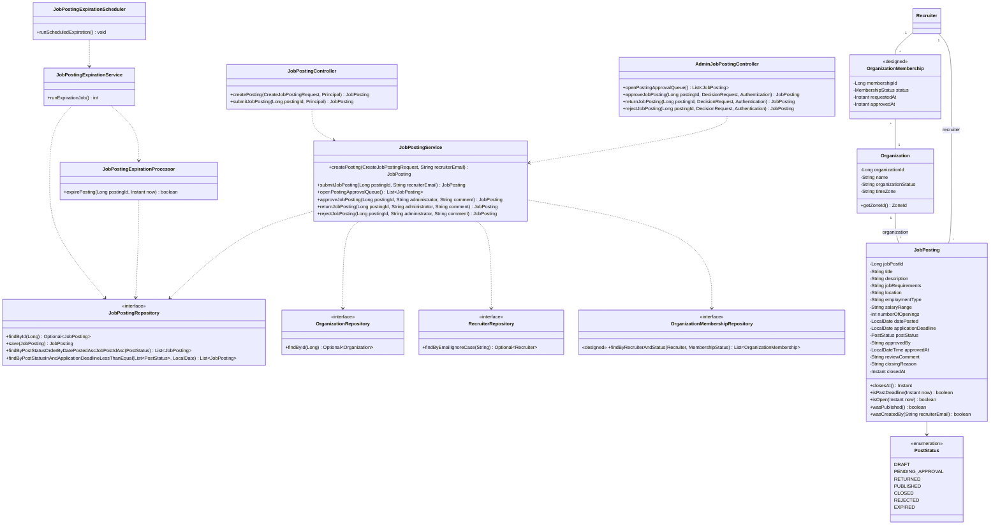

**Figure 36: DCD, job-posting side (UC-11 to UC-13)**
