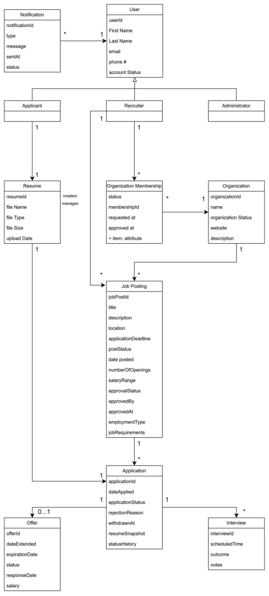

# CareerBridge — Domain model

> Part of the CareerBridge specification — see the [index](README.md). Section numbers are those of the project documentation, so references such as "section 4.3" work across files.

## 5. Domain Model (Analysis)

Figure 25 shows CareerBridge's conceptual classes, their attributes and the associations between them, with multiplicities. It models what exists in the job-board domain: users in their three roles, organizations and memberships, job postings, applications with their resume copy and history, interviews, offers and notifications. The operation contracts in section 4.3 are written with these class and attribute names.

**Figure 25: CareerBridge domain model** (as drawn for Iteration 1; sections 5.1 to 5.3 are the current model, and section 5.4 lists where they differ from the figure)

### 5.1 Classes and attributes

The current model, as text. This is what code and tickets refer to. Names are spelled as in
Figure 25; classes and associations that are not in the figure are listed in section 5.4.

| Class | Attributes |
| --- | --- |
| User | userId, First Name, Last Name, email, phone #, account Status, password (kept only as a salted hash, NFR-UC02.1), failed log-ins, locked until (A15) |
| Applicant | none of its own (a kind of User) |
| Recruiter | none of its own (a kind of User) |
| Administrator | none of its own (a kind of User) |
| Resume | resumeId, file Name, file Type, file Size, upload Date |
| Application | applicationId, dateApplied, applicationStatus, rejectionReason, withdrawnAt |
| Resume Snapshot | file Name, file Type, file Size |
| Status History Entry | status, date |
| Organization Membership | status, membershipId, requested at, approved at |
| Organization | organizationId, name, organization Status, website, description, timeZone |
| Job Posting | jobPostId, title, description, location, applicationDeadline, postStatus, date posted, numberOfOpenings, salaryRange, approvalStatus, approvedBy, approvedAt, reviewComment, employmentType, jobRequirements, closingReason, closedAt |
| Offer | offerId, dateExtended, expirationDate, status, responseDate, salary |
| Interview | interviewId, scheduledTime, outcome, notes |
| Notification | notificationId, type, message, sentAt, status |

- **Resume Snapshot** is the copy of the resume kept with an application as it was at submission
  (A6). The operation contracts call it the Application's _resumeSnapshot_.
- **Status History Entry** is one stage an application reached, with the date. The operation
  contracts call the entries of an application its _statusHistory_.
- A **Job Posting**'s _location_ is On-site, Hybrid or Remote (UC-11 step 3), and its
  _employmentType_ is Full-time, Part-time, Internship, Contract or Temporary. The job board
  filters by these same values (UC-01 step 3).
- An **Organization**'s _timeZone_ is where its deadlines are read: a **Job Posting** stops
  accepting applications at 23:59 on its _applicationDeadline_ in that zone (UC-13 variation 2a,
  NFR-UC13.5). An organization with no zone recorded uses UTC.
- A **Job Posting** closed by the system or a recruiter keeps why in _closingReason_ (Expired, for
  UC-13) and when in _closedAt_, a UTC instant.

### 5.2 Generalization

Applicant, Recruiter and Administrator are specializations of User.

### 5.3 Associations

Multiplicities are read as "one A is linked to … B".

| From | Multiplicity | To | Multiplicity | Meaning |
| --- | --- | --- | --- | --- |
| Notification | * | User | 1 | A notification is addressed to one user; a user has many notifications. |
| Applicant | 1 | Resume | 0..1 | An applicant has at most one resume on file; a new applicant has none yet. |
| Applicant | 1 | Application | * | An applicant submits applications: at most 5 active (BR-4, A7) and at most one per job posting (A5). |
| Job Posting | 1 | Application | * | An application is for one job posting. |
| Application | 1 | Resume Snapshot | 1 | An application keeps a copy of the resume as it was at submission (role name resumeSnapshot). |
| Application | 1 | Status History Entry | 1..* | An application records each stage it reached (role name statusHistory). |
| Recruiter | 1 | Organization Membership | * | A recruiter has a membership for each organization they recruit for. |
| Organization Membership | * | Organization | 1 | Each membership is in one organization. |
| Organization | 1 | Job Posting | * | A job posting belongs to one organization. |
| Recruiter | 1 | Job Posting | * | A job posting is created by one recruiter. |
| Application | 1 | Offer | 0..1 | An application has at most one offer. |
| Application | 1 | Interview | * | An application has any number of interviews. |

### 5.4 Differences from Figure 25

The figure was drawn for Iteration 1 and has not been redrawn. The text above corrects it in eight
places: five needed for UC-04 Apply for Job, one for UC-12 Approve Job Posting and two for UC-13
Expire Job Posting:

| # | Figure 25 | Current model | Why |
| --- | --- | --- | --- |
| 1 | No association between Applicant and Application | Applicant 1 — * Application | UC-04 postcondition: "A new application exists in the Applied stage, linked to the Applicant and the posting". The limit of 5 active applications (BR-4) and the no-reapply rule (A5) are both about the applicant's applications. |
| 2 | Resume 1 — 1 Application | Removed; Application 1 — 1 Resume Snapshot instead | An applicant has one resume and many applications, so 1 — 1 cannot hold. The application must not follow later changes to the resume (A6), so it keeps a copy, not a link to the resume on file. |
| 3 | Applicant 1 — 1 Resume | Applicant 1 — 0..1 Resume | UC-02 postcondition: "An empty applicant profile with no resume has been created". UC-04 extension 2a handles an applicant with no resume. |
| 4 | Application has the attribute resumeSnapshot | Class Resume Snapshot (file Name, file Type, file Size) | The copy has its own data ("available as a PDF or DOCX, in the format the applicant uploaded"), so it is a class, not a simple attribute. |
| 5 | Application has the attribute statusHistory | Class Status History Entry (status, date) | The history has one entry per stage, each with its own date, so it is a class, not a simple attribute. |
| 6 | Job Posting has no review comment; approvedBy and approvedAt suggest an approval only | Job Posting has reviewComment; approvedBy and approvedAt record the Administrator who made any decision (approve, return or reject) and when | UC-12 requires comments to return or reject a posting (extensions 5a, 5b), and logs every decision with who decided and when (Special Requirements). |
| 7 | Organization has no time zone | Organization has timeZone | UC-13 variation 2a: a deadline means 23:59 on that date in the organization's time zone (A11, NFR-UC13.5). |
| 8 | Job Posting does not record how or when it closed | Job Posting has closingReason and closedAt | UC-13 closes an overdue posting with the reason Expired and the time it closed (FR-UC13.3). |

Two more things in the figure are not carried into the text:

- The Organization Membership box shows a line "+ item: attribute". It is a leftover of the
  drawing tool, not an attribute.
- A label "creates\ manages" floats beside the Resume box without touching a line. It is read as
  the meaning of Applicant — Resume.

### 5.5 Known gaps, for later use cases

A review of the model against the whole specification found these. They do not affect UC-04 and
are left for the iteration that implements the use cases named.

| Class | Gap | Where it comes from |
| --- | --- | --- |
| Applicant | No location, headline, skills, education, work experience | UC-03 step 2, FR-UC03.1 |
| Recruiter | No job title | UC-08 step 3 |
| Organization | No industry, headquarters location, size | UC-08 step 3 |
| Organization Membership | No role, justification, denial reason, review flag; no link to the deciding Administrator | CO-09.1; UC-10; A17 |
| Job Posting | approvedBy is an attribute, not an association to Administrator; approvalStatus repeats postStatus; no submission date | CO-12.1; UC-12; Close Job Posting |
| Offer | No start date, other terms, offer letter | UC-15 postconditions; CO-07.1 |
| Interview | No format, location, interviewers; the limit of two rounds (A13) is not in the multiplicity | FR-UC14.7; CO-14.4 |
| Status History Entry | No note or reason, no link to the Recruiter who made the change | CO-14.2, CO-14.3, CO-06.2, CO-07.3 |

Wording elsewhere in the specification that still follows the figure and should be aligned with
5.3 when those use cases are implemented:

- Business rule BR-6 says "exactly one resume on file"; UC-02 and UC-03 say "at most one".
- CO-03.3 says the previous Resume "was dissociated from the Applicant"; with Applicant 1 — 0..1
  Resume it is replaced.
- CO-14.2, CO-14.3, CO-14.4, CO-15.1 and CO-15.2 say "the Applicant who owns the Application's
  Resume"; it is the Applicant who submitted the Application.
