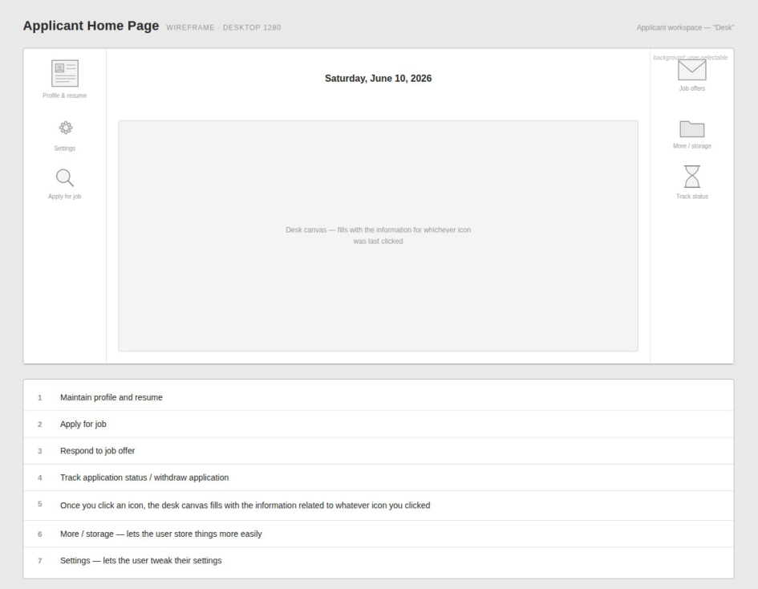
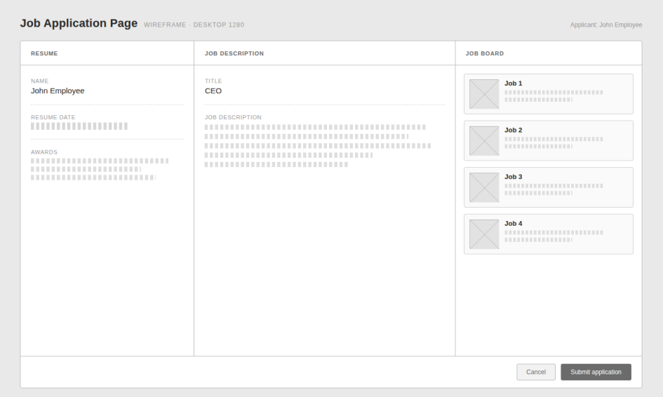
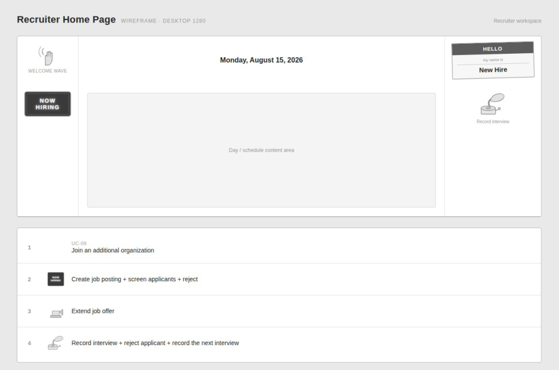
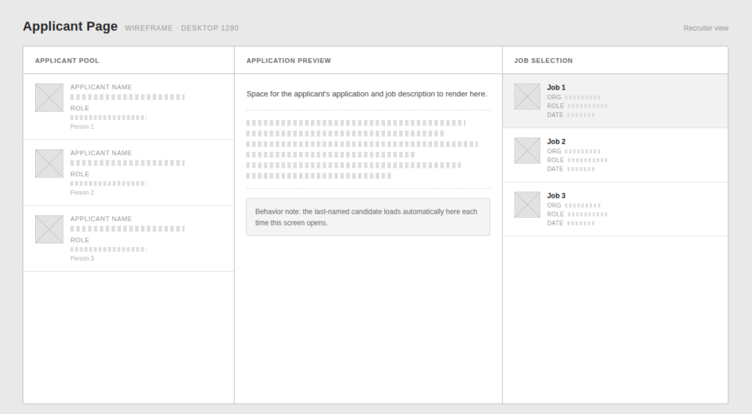
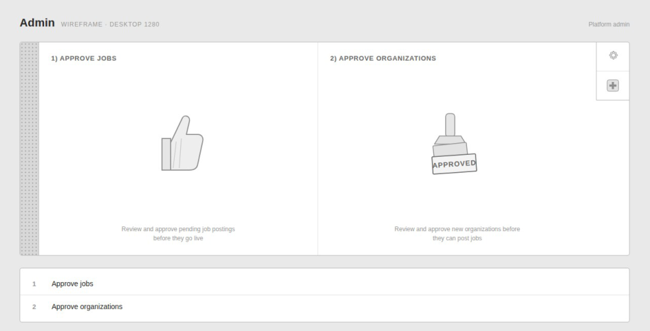

# CareerBridge — UI drafts

> Part of the CareerBridge specification — see the [index](README.md). Section numbers are those of the project documentation, so references such as "section 4.3" work across files.

### 4.4 UI Initial Drafts

Low-fidelity wireframes (desktop, 1280 pixels wide) for the main screens of each actor, one per figure. Each description names the use cases the screen serves.

#### Applicant Home Page

Figure 20. The applicant's workspace. Its icons open Update Applicant Profile (UC-03), Apply for Job (UC-04), Track Application Status (UC-05), Withdraw Application (UC-06) and Respond to Job Offer (UC-07) in the central canvas.

**Figure 20: Applicant Home Page wireframe**

#### Job Application Page

Figure 21. The screen for Apply for Job (UC-04): the applicant's resume on file, the chosen posting's description and other open postings (UC-01), with Cancel and Submit application.

**Figure 21: Job Application Page wireframe**

#### Recruiter Home Page

Figure 22. The recruiter's workspace, with entry points for Join Additional Organization (UC-09), Create Job Posting (UC-11), Screen Applications, including rejections and interview records (UC-14), and Extend Job Offer (UC-15).

**Figure 22: Recruiter Home Page wireframe**

#### Applicant Page (recruiter view)

Figure 23. The screen for Screen Applications (UC-14): the applicant pool for the selected posting, a preview of the chosen application with the job description, and the organization's postings.

**Figure 23: Applicant Page (recruiter view) wireframe**

#### Admin

Figure 24. The Administrator's workspace, with its two approval actions: Approve Job Posting (UC-12) and Approve Recruiter/Organization Request (UC-10).

**Figure 24: Admin wireframe**

#### Screens by role

The wireframes above fix what each actor's workspace holds. This part fixes how the site is
organized around the actors: what each one sees after logging in, which screens they reach, and
where each use case and each hand-off between use cases lives. It is the catalog of screens: each
screen has an ID, and its mockup at the three widths of [ADR-0004](adr/0004-frontend.md) is
`screens/<ID>.html`, with a picture beside it ([screens/](screens/README.md)). A page is built to
match its mockup, and a screen that is not listed here is added before it is coded
([ADR-0011](adr/0011-screens-are-built-from-mockups.md)).

**Principles**

1. **One workspace per role.** The header, the navigation and the home page are chosen by the
   role of the logged-in user: Visitor, Applicant, Recruiter, Administrator, plus a recruiter whose
   request is still pending. Nobody sees another role's entries.
2. **Home answers "what needs me now".** A home page is not a menu of icons. It lists what is
   waiting for this user, most urgent first, each item one click from its use case.
3. **Every use case has one place, and every hand-off is a link** (table "Hand-offs" below).
4. **A screen of another role is closed, not only hidden.** A logged-in user who opens another
   role's address goes to their own home; a visitor goes to Log In and comes back after it. The job
   board stays open to everyone (UC-01 serves all actors through generalization), but only the
   Visitor and the Applicant have it in their navigation.
5. **Final actions are confirmed.** Withdraw, accept, decline, reject an application, reject a
   posting and deny a request open a dialog that says what cannot be undone (BR-5, BR-13, A5, A8).
6. **Every application, posting and request has its own address**, so a notice or a colleague can
   point straight to it (UC-05, technology variation 1a).
7. **A recruiter works in one organization at a time.** The organization switcher sits in the
   header, and every recruiter screen shows only that organization's data (UC-09 special
   requirements, A16, BR-15).
8. **The phone dock holds at most four entries.** Rare actions live in the account menu.
9. **Images only where they mean something.** Organization logos on postings and in the
   recruiter's organization switcher (UC-08, technology variation 3a), with the organization's
   initials when none was uploaded; one illustration on the visitor's front page; small
   illustrations in empty states. Working screens have none. Images come under a free license
   (Unsplash, unDraw), are recolored to the theme and are served from `app/frontend/public/`.

**Navigation**

| Role | Home after log in | Navigation (side column, tiles, phone dock) | Header |
| --- | --- | --- | --- |
| Visitor | `/` job board front page | none: the content takes the full width | Search, Log in, Register (job seeker or employer) |
| Applicant | `/` desk | Home · Find jobs · Applications (marked while an offer waits) · Profile | Search, account menu |
| Recruiter, pending | `/recruiter/status` | none | Account menu (Log out) |
| Recruiter | `/recruiter` | Home · Postings · Organizations | Organization switcher, account menu |
| Administrator | `/admin` | Home · Posting approvals · Recruiter requests (each with its count) | Account menu |

**Visitor**

| ID | Address | Screen | Use cases | Holds and leads to |
| --- | --- | --- | --- | --- |
| [`visitor-home`](screens/visitor-home.html) | `/` | Front page | UC-01, UC-02, UC-08 | Search box, the newest published postings, and two ways in: "Looking for a job" (UC-02) and "Hiring" (UC-08). |
| [`visitor-jobs`](screens/visitor-jobs.html) | `/jobs` | Job board | UC-01 | Keywords, location, organization and employment type; results newest first; the empty texts of extensions 2a and 2b; the criteria kept after a failure (\*a). |
| [`visitor-posting`](screens/visitor-posting.html) | `/jobs/{id}` | Posting | UC-01, UC-04 1a | Every detail of the posting. Apply leads to Log In or Register and back to this posting. |
| [`visitor-register`](screens/visitor-register.html) | `/register` | Register as applicant | UC-02 | Name, email, password with the policy shown. Done: the Profile with an invitation to add a resume. Link "Hiring? Register your organization" (1a). |
| [`visitor-recruiter-register`](screens/visitor-recruiter-register.html) | `/recruiter/register` | Register recruiter and organization | UC-08 | Two parts, "You" and "Your organization". A known organization offers a membership request instead (4c). Done: "Check your email", then the request status. |
| [`visitor-login`](screens/visitor-login.html) | `/login` | Log In | Log In | Returns to the page that sent the user here, or to the role's home. |

**Applicant**

| ID | Address | Screen | Use cases | Holds and leads to |
| --- | --- | --- | --- | --- |
| [`applicant-home`](screens/applicant-home.html) | `/` | Desk | UC-05, UC-07, UC-03 | In this order: an offer waiting for an answer, with its deadline; "Add a resume" while none is on file (BR-6); active applications with stage and date of the last change; "N of 5 active"; recently published postings. |
| [`applicant-jobs`](screens/applicant-jobs.html) | `/jobs` | Job board | UC-01 | As for the Visitor, plus "Applied · stage" on postings already applied to. |
| [`applicant-posting`](screens/applicant-posting.html) | `/jobs/{id}` | Posting | UC-01, UC-04 | As for the Visitor. Apply leads to the Apply page, or says why it is unavailable: 5 active applications (UC-04 2b) or an earlier application (4c). |
| [`applicant-apply`](screens/applicant-apply.html) | `/jobs/{id}/apply` | Apply | UC-04 | Posting, contact details, resume on file with "Update resume" (3a), "3 of 5 active", the note that an application cannot be edited (BR-5), Submit. The blocked cases 1c, 2a, 2b and 4c each say what to do next. Done: "4 of 5 active" and a link to the new application. |
| [`applicant-applications`](screens/applicant-applications.html) | `/applications` | Applications | UC-05 | Active first, filter Active / Closed (2b), "N of 5 active". None yet: a link to the job board (2a). |
| [`applicant-application`](screens/applicant-application.html) | `/applications/{id}` | Application | UC-05, UC-06, UC-07 | Posting and current stage; the stage history with dates and interview details, never outcomes (A12); the rejection reason (4a, 4b) or withdrawal date (4c). At Applied, Screening or Interview: Withdraw, with a reason from the list of A18. At Offer: the terms, the deadline, Accept and Decline (UC-07); after the deadline only the terms. |
| [`applicant-profile`](screens/applicant-profile.html) | `/profile` | Profile and resume | UC-03 | Profile details form; the resume card with file name, upload date and Replace; the accepted types and size (6a). |

There is no separate Offers screen. An offer is the Offer stage of an application (UC-05 5b), so it
is shown on that application's page; the desk and the Applications entry point to it.

**Recruiter**

| ID | Address | Screen | Use cases | Holds and leads to |
| --- | --- | --- | --- | --- |
| [`recruiter-status`](screens/recruiter-status.html) | `/recruiter/status` | Request status | UC-08 \*a, BR-14 | For a recruiter without an Active membership: the request's state (email not verified, under review, information requested, denied with reason). Nothing else is reachable. |
| [`recruiter-home`](screens/recruiter-home.html) | `/recruiter` | Home | UC-14, UC-15, UC-11, UC-13 | For the current organization: new applications to review, by posting; interviews coming up and interviews without an outcome; offers waiting for an answer, and offers past their deadline that still need a decision (A14); postings that need the recruiter: Returned with comments, Drafts, Expired before publication (UC-13 2b). |
| [`recruiter-postings`](screens/recruiter-postings.html) | `/recruiter/postings` | Postings | UC-11, UC-14 step 2 | Filter by status: Published (with the number of applications at each stage), Pending Approval, Returned, Draft, Closed (Filled or Expired), Rejected. New posting. |
| [`recruiter-posting-form`](screens/recruiter-posting-form.html) | `/recruiter/postings/new`, `/recruiter/postings/{id}/edit` | Posting form | UC-11 | "Posting for: organization"; start from an earlier posting (3a); Save draft (3b) or Submit for approval. On a Returned posting, the Administrator's comments above the form (6a). |
| [`recruiter-posting`](screens/recruiter-posting.html) | `/recruiter/postings/{id}` | Posting and its applicants | UC-14, UC-11 | Status, openings, accepted and outstanding offers, the public page when Published. Applicants by stage: Applied, Screening, Interview, Offer, Closed (Hired, Rejected, Withdrawn, Offer Declined), with counts. Choose several and advance them together (5d). None yet: 3a. |
| [`recruiter-review`](screens/recruiter-review.html) | `/recruiter/applications/{id}` | Application review | UC-14, UC-15 | The resume copy (A6), the applicant's profile details, this application's stage history and internal notes, and nothing about the applicant's other applications (BR-15). The main action follows the stage: Move to Screening, Move to Interview, Extend offer at Interview, Revise offer at Offer. Record interview or outcome at Interview, at most two rounds (A13). Reject at any active stage, with a reason and a comment for the applicant, warning at Offer that the offer is rescinded. After an action: the next application of the same stage. |
| [`recruiter-offer`](screens/recruiter-offer.html) | `/recruiter/applications/{id}/offer` | Offer | UC-15 | Job title from the posting; openings, accepted and outstanding offers; the warnings 2a and 2b; start date, compensation, other terms, deadline (7 days by default), letter; a preview as the applicant will see it; Send. |
| [`recruiter-organizations`](screens/recruiter-organizations.html) | `/recruiter/organizations` | Organizations | UC-09 | Memberships with their status; cancel a pending request (\*a); Join an organization: search, summary, role and justification. |

**Administrator**

| ID | Address | Screen | Use cases | Holds and leads to |
| --- | --- | --- | --- | --- |
| [`admin-home`](screens/admin-home.html) | `/admin` | Home | UC-12, UC-10 | Both queues with their size and how long the oldest item has waited, against the targets of one business day for postings and two for requests; requests flagged for review (UC-08 4d). |
| [`admin-postings`](screens/admin-postings.html) | `/admin/postings` | Posting approvals | UC-12 | Oldest first: title, organization, recruiter, submission date, deadline, with deadlines already passed marked (6a). On a laptop the list and the chosen posting side by side; on a phone the list opens the posting. |
| [`admin-posting`](screens/admin-posting.html) | `/admin/postings/{id}` | Posting review | UC-12 | The posting as the public will see it, drawn by the same component as `/jobs/{id}` (technology variation 4a), and the organization's status. Approve, Return with comments, Reject with a reason. After a decision: the next posting in the queue (step 8). The blocked cases 6a and 6b say why. |
| [`admin-requests`](screens/admin-requests.html) | `/admin/requests` | Recruiter requests | UC-10 | Oldest first: request type (new organization, joining an existing organization, an additional organization), requester, organization, date, review flags. |
| [`admin-request`](screens/admin-request.html) | `/admin/requests/{id}` | Request review | UC-10 | Requester (name, work email, job title, memberships), organization with a link to its website (5a), justification. Approve, Deny with a reason, Ask for information; for a duplicate organization, approve the membership in the existing one (5c). |

UC-13 Expire Job Posting has no screen: its results appear as Closed · Expired and Expired on the
recruiter's postings and home.

**Hand-offs**

| From | To | Where |
| --- | --- | --- |
| UC-01 posting | UC-04 Apply | Apply on `/jobs/{id}` |
| UC-02 done | UC-03 | The Profile, inviting a resume |
| UC-02 1a | UC-08 | "Hiring? Register your organization" |
| UC-04 2a, 3a | UC-03, then back to UC-04 | "Add resume" or "Update resume" returns to the same Apply page |
| UC-04 done | UC-05 | Link to the new application |
| UC-05 | UC-06, UC-07 | Actions on `/applications/{id}` |
| UC-06 4a | UC-07 | The offer on the same application page |
| UC-08 4b | Log In, UC-09 | "You already have an account" |
| UC-12 5a | UC-11 6a | The Returned posting on the recruiter's home and Postings |
| UC-14 | UC-15 | Extend offer on the application review |
| UC-15 1a | UC-14 | Back to the application review |
